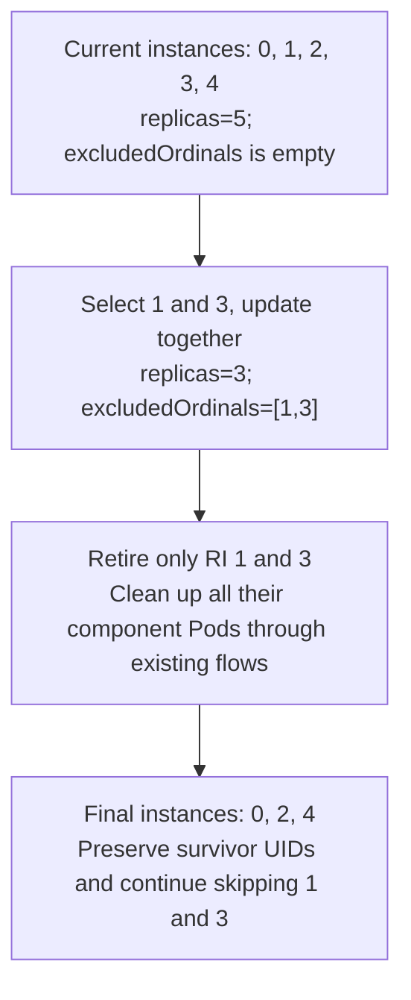
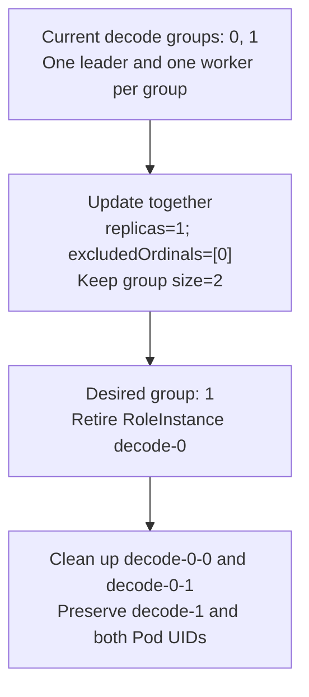
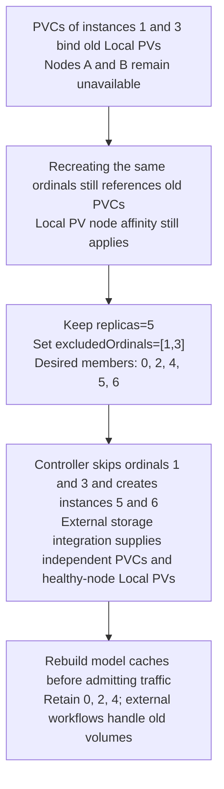
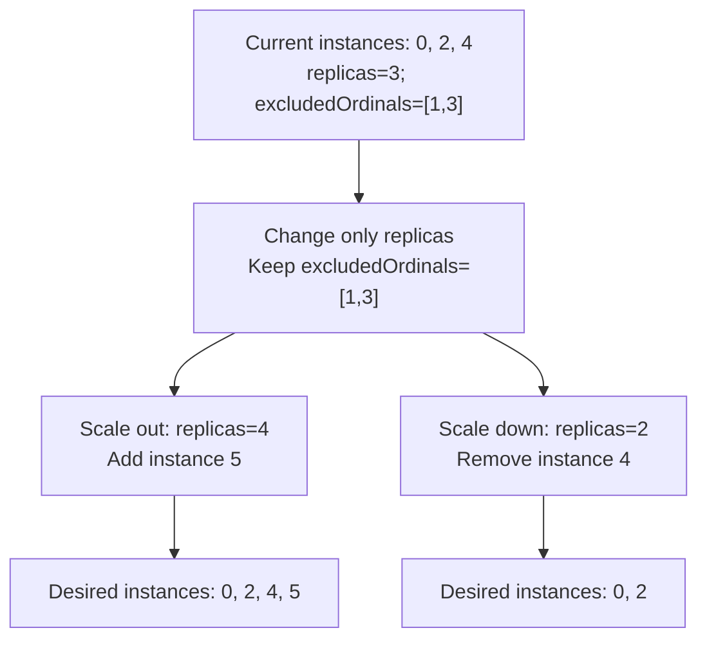
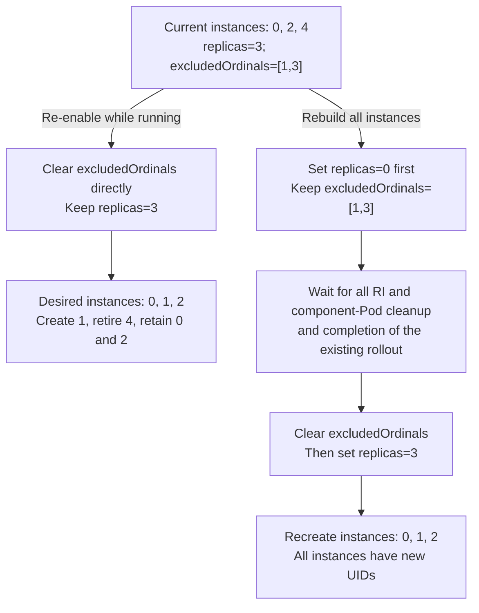

# KEP-499: Stateful selective scale-down

English | [简体中文](README.zh-CN.md)

<!-- toc -->
- [KEP-499: Stateful selective scale-down](#kep-499-stateful-selective-scale-down)
  - [Summary](#summary)
  - [Motivation](#motivation)
    - [Goals](#goals)
    - [Non-Goals](#non-goals)
  - [Proposal](#proposal)
    - [User Stories](#user-stories)
      - [Selective Scale-Down](#selective-scale-down)
      - [Replacing Instances with New Ordinals](#replacing-instances-with-new-ordinals)
      - [Subsequent Scaling](#subsequent-scaling)
      - [Re-enabling Ordinals](#re-enabling-ordinals)
    - [Notes/Constraints/Caveats](#notesconstraintscaveats)
  - [Design Details](#design-details)
    - [API](#api)
    - [Desired Membership](#desired-membership)
    - [Validation and Conversion](#validation-and-conversion)
    - [A Shared Ordinal Planner](#a-shared-ordinal-planner)
    - [Impact of Re-enabling Ordinals on Update Strategy](#impact-of-re-enabling-ordinals-on-update-strategy)
      - [Re-enabling one ordinal](#re-enabling-one-ordinal)
      - [Per-operation limits](#per-operation-limits)
      - [Effect on partition](#effect-on-partition)
      - [Shared rules](#shared-rules)
    - [ScalingAdapter and Other Writers](#scalingadapter-and-other-writers)
    - [Implementation Plan](#implementation-plan)
    - [Test Plan](#test-plan)
      - [Prerequisite Testing Updates](#prerequisite-testing-updates)
      - [Unit Tests](#unit-tests)
      - [Integration Tests](#integration-tests)
      - [End-to-End Tests](#end-to-end-tests)
    - [Graduation Criteria](#graduation-criteria)
    - [Upgrade / Downgrade Strategy](#upgrade--downgrade-strategy)
    - [Version Skew Strategy](#version-skew-strategy)
    - [Open Questions](#open-questions)
  - [Production Readiness Review Questionnaire](#production-readiness-review-questionnaire)
    - [Feature Enablement and Rollback](#feature-enablement-and-rollback)
    - [Dependencies](#dependencies)
  - [References](#references)
<!-- /toc -->

## Summary

This KEP adds ordinal-based selective scale-down to native Stateful RoleInstanceSets.
A RoleInstance is a complete replica and may contain multiple component Pods.
With native RIS `leaderWorkerPattern`, each RoleInstance is one leader/worker group:
`replicas` counts groups, while `leaderWorkerPattern.size` counts Pods per group.
This proposal supports selecting whole groups for retirement, not permanently
removing an individual Pod from a group.
Operators can choose which instances to retire while preserving unrelated survivor
names, ordinals, and UIDs during isolated scale-down with unchanged templates and
no independent lifecycle event.

Add optional `excludedOrdinals` to RBG `spec.roles[i]` and standalone RIS `spec`.
`replicas` remains the desired instance count; `excludedOrdinals` identifies ordinals
the controller must persistently skip. Each RoleInstance occupies a logical slot with a
stable ordinal; in leader/worker mode, one slot represents the whole group. The
ordinal is an identity, not a list position or a node resource slot. `replicas`
counts instances rather than defining an upper bound on ordinals. Select eligible
ordinals starting from 0 until the count is met. Retirement removes the entire RoleInstance and all its
component Pods.

For a running set `[0,1,2,3,4]`, retire 1 and 3 by updating `replicas=3` and
`excludedOrdinals=[1,3]` together, producing `[0,2,4]`. A controller restart still skips
1 and 3. Later increasing `replicas` to 4 adds ordinal 5, producing `[0,2,4,5]`.
Adding exclusions without reducing `replicas` instead fills the count at other
ordinals: that replaces capacity rather than shrinking it.

Exclusions are durable desired state and are not automatically cleared after
scale-down. Absent or empty exclusions retain existing behavior. Nonempty
exclusions use one ordinal plan across creation, deletion, and rolling updates.
Updates retain partition, maxSurge, and maxUnavailable; their sparse-membership
adaptation is described in Design Details.

## Motivation

A stateful inference replica can contain valuable local model state, warm caches,
or multiple cooperating component Pods. During node maintenance, relocation, or
application migration, the desired retirement targets may be low ordinals rather
than the highest ordinals chosen by ordinary scale-down.

Reducing only `replicas` can remove healthy higher ordinals. Directly deleting a
RoleInstance leaves its desired identity unchanged, so reconciliation recreates
it. A one-shot deletion request cannot express that an identity must stay absent.

As of upstream main `a0b11e6a`:

- RoleSpec and RoleInstanceSetSpec do not expose `excludedOrdinals`.
- The stateful topology contains an always-empty exclusion set as a future hook.
- Some stateful creation and rollout paths still use dense ordinal intervals.
- `scaleStrategy.roleInstanceToDelete` is consumed by the stateless flow; it is
  not a persistent stateful identity-retirement mechanism.

The proposal unifies ordinal planning for base and additional instances so that
creation, deletion, and rolling updates support sparse ordinals.

### Goals

- Persistently skip selected ordinals while keeping `replicas` as a count.
- Preserve unrelated survivor names, ordinals, and UIDs during isolated selective
  scale-down with unchanged templates and no independent lifecycle event.
- Support selective scale-down of whole leader/worker groups by retiring each
  RoleInstance as a unit, including all its component Pods.
- Support native Stateful RoleInstanceSets created directly or through RBG roles.
- Preserve existing ownership checks, partition counts, maxSurge/maxUnavailable
  budgets, paused-rollout behavior, and controller-restart recovery with sparse ordinals.
- Preserve existing behavior when exclusions are absent or empty.

### Non-Goals

- Automatic target selection, failure handling, traffic cutover, data migration,
  or execution guarantees after node loss.
- Selective scale-down of individual component Pods, changes to within-group topology,
  or external workload backends. Whole leader/worker groups managed by native RIS
  are in scope; existing stateless specified deletion is unchanged.
- Cross-object transactions or a new imperative scale API.
- Changing starting ordinals, automatic renumbering or exclusion expiry, or PVC management.
- Extending lifecycle hooks, scheduling, service discovery, or rollback-protection state.

## Proposal

Add `excludedOrdinals` alongside `replicas` to define desired membership.
Reducing replicas changes capacity; excluding ordinals specifies which instances must stay absent.

### User Stories

The four scenarios below describe configuration and membership changes as proposed
behavior. Examples assume unchanged templates and no independent lifecycle event;
actual creation and deletion follow existing control policies. RBG users update
the role configuration; standalone RIS users update the set directly.

`replicas` determines the desired instance count, and `excludedOrdinals` identifies
ordinals the controller must persistently skip. Together they determine desired
membership; the controller does not infer the user's business intent.

Selective scale-down, replacement using new ordinals, subsequent scaling, and
re-enabling ordinals all use the same membership planner, without separate
scenario switches or replacement policies.

- Reduce `replicas` and exclude selected ordinals for selective scale-down.
- Keep `replicas` unchanged and exclude selected ordinals to fill the count at
  other eligible ordinals.
- Change `replicas` while retaining exclusions for subsequent scaling.
- Remove ordinals from exclusions to allow the controller to use them again.

Creation and retirement follow existing control policies and applicable budgets.

#### Selective Scale-Down

**Typical background.** Inference demand falls and the
decode role should shrink from five instances to three, releasing GPU capacity.
Operators have selected instances 1 and 3 for retirement, for example because
they involve maintenance nodes or appear in a resource-reclamation plan.
Instances 0, 2, and 4 have already loaded and warmed the model and should continue
running. Reducing replicas alone may remove higher ordinals 3 and 4, so it cannot
express the intent to retain 4 and remove 1. Select both the retirement ordinals
and desired count, targeting each whole RoleInstance and all its component Pods.

**Operation and result.** To reduce capacity and choose which instances leave, reduce `replicas` and add
selected ordinals to `excludedOrdinals` together. From `[0,1,2,3,4]`, remove 1 and 3
by updating `replicas=3`, `excludedOrdinals=[1,3]` in one request. The final set is
`[0,2,4]`, retaining survivor names, ordinals, and UIDs. Merge existing exclusions;
retries submit the same absolute target without subtracting replicas again.



**Leader/worker group selective scale-down.** A decode role has two groups,
each containing one leader and one worker. Operators want to reclaim group 0's
resources while retaining group 1, which has already loaded the model.
This scenario applies to native Stateful RIS with `leaderWorkerPattern`; it does
not add support for an external LeaderWorkerSet backend. Workload prefixes are
omitted below:

| RoleInstance (group) | Leader Pod | Worker Pod | Action |
| --- | --- | --- | --- |
| `decode-0` | `decode-0-0` | `decode-0-1` | Retire the whole group |
| `decode-1` | `decode-1-0` | `decode-1-1` | Retain the whole group |

In one update, change the decode role from `replicas=2` with empty exclusions
to `replicas=1`, `excludedOrdinals=[0]`, keeping `leaderWorkerPattern.size=2`.
The following is only a proposed role-field fragment; edit the existing
configuration while preserving other roles and template fields:

```yaml
name: decode
replicas: 1
excludedOrdinals: [0]
leaderWorkerPattern:
  size: 2
```

The excluded ordinal `0` is the group ordinal, not a within-group Pod index. Retire
RoleInstance `decode-0` and clean up its two Pods through existing flows. Retain
`decode-1` and both of its Pods with their names and UIDs unchanged. Component Pod
cleanup is asynchronous; simultaneous disappearance is not guaranteed.
Only decode changes here; the desired prefill and router configurations remain
unchanged. P/D groups with matching ordinals do not have to retire together.
Keeping `replicas=2` while setting `excludedOrdinals=[0]` would instead fill capacity
with group 2, making this group replacement.



**Why individual component Pod selective scale-down is excluded.** Permanently
removing only `decode-0-1` while retaining its leader changes within-group
membership and runtime topology, rather than the RoleInstance count.
Deleting a Pod alone does not reduce the desired component count, so the
controller replaces it. Changing the role-wide `leaderWorkerPattern.size`
changes the target size of every group; it cannot select a worker in one group.
Cooperative inference such as TP/PP also requires engine support for topology
reconfiguration; deleting a Pod alone cannot ensure the other members keep serving.
This proposal therefore selects whole-group identities without introducing
within-group Pod exclusions or an elastic topology protocol. Individual Pod
failure recovery continues to follow existing policies. Existing application
or operator workflows handle request draining and remaining-capacity checks;
this feature does not guarantee request-level zero interruption.

#### Replacing Instances with New Ordinals

Keep `replicas` unchanged and add the ordinals of the instances to replace to
`excludedOrdinals`. The controller continues skipping those ordinals and fills
the replica count using other eligible ordinals, retaining the other instances.

For example, start with `replicas=5` and instances `[0,1,2,3,4]`.
Setting `excludedOrdinals=[1,3]` makes the desired instances `[0,2,4,5,6]`:

| Instance ordinals | Action |
| --- | --- |
| 1, 3 | Retire and continue skipping during subsequent reconciliation |
| 5, 6 | Create new instances to fill the desired count |
| 0, 2, 4 | Retain |

Creation and retirement order follow existing control policies. `replicas=5`
specifies the desired count, not five available instances throughout replacement,
and does not guarantee replacement readiness before retirement.

The same mechanism supports selective scale-down. For example, first shrink to
three instances while excluding `[1,3]`, then keep the exclusions and scale back
to five: the result is also `[0,2,4,5,6]`. This scenario therefore has no separate
enablement switch.

**Application example: Local PVs tied to unavailable nodes.**

If an instance's PVC is bound to a Local PV on an unavailable node, recreating
the same ordinal can still reference the old PVC and remain constrained by its
node affinity. Creating instances at new ordinals can work with an existing
external storage integration to supply independent PVCs and Local PVs on healthy
nodes. See [Kubernetes Local volumes](https://kubernetes.io/docs/concepts/storage/volumes/#local)
for the node-affinity constraint.

This example requires:

- An external storage integration that assigns and mounts independent PVCs by
  instance ordinal. If the template uses a fixed `claimName`, changing the ordinal
  still references the same PVC.
- Model files and caches that can be downloaded or rebuilt from an external
  source. Irreplaceable application data requires separately arranged replication
  or recovery.
- External handling of storage lifecycle. Native RIS has no StatefulSet-style
  `volumeClaimTemplates`, and this proposal adds none. It does not migrate data,
  reclaim old volumes, or force-delete objects on failed nodes.

The diagram uses instances 1 and 3 with PVCs tied to Local PVs on nodes A and B,
and shows external storage supplying new instances at ordinals 5 and 6.
Old-object cleanup can block, and new instances can remain Pending without
suitable volumes.



#### Subsequent Scaling

**Typical background.** After selective scale-down, the decode role retains
`[0,2,4]` with exclusions `[1,3]`. Maintenance is still in progress, so 1 and 3
must remain excluded. Evening demand requires scaling from three instances to four,
while a later quiet period requires only two. Operators or autoscalers change only
`replicas`, preserving exclusions so that added capacity uses other ordinals
instead of recreating the retired identities. HPA and ScalingAdapter use must
also preserve exclusions.

**Operation and result.** To change capacity only, update `replicas` and keep `excludedOrdinals`. Starting
from `[0,2,4]` with `excludedOrdinals=[1,3]`, scaling out to 4 instances adds 5;
scaling down to 2 instances removes 4. Neither case recreates 1 or 3.



#### Re-enabling Ordinals

**Typical background.** Instances 1 and 3 were excluded for temporary maintenance,
and the decode role now retains `[0,2,4]`. After maintenance, operators explicitly
decide to re-enable the excluded ordinals so the controller can use them again.
Clearing exclusions with the desired count still at three creates 1, retires 4,
and retains 0 and 2. This is an intentional membership change, not a required step
after selective scale-down, and node recovery does not trigger it automatically.

Another scenario is a planned shutdown and service redeployment: stop all instances
and complete cleanup, clear exclusions, and scale out again to rebuild numbering
from 0. There is no need to clear exclusions merely to make numbering dense;
the service can continue using sparse ordinals.

**Operation and result.** Remove the selected ordinals from `excludedOrdinals` to
allow the controller to use them again. The replica count and exclusions together
determine which instances are created. Membership is recalculated even if
`replicas` is unchanged. With `replicas=3`, clearing exclusions for `[0,2,4]` yields `[0,1,2]`: create 1, retire 4, and retain 0 and 2.
Any instance that needs to be recreated has a new UID.
Creation and retirement order depend on remaining rollout budgets; see
[Impact of Re-enabling Ordinals on Update Strategy](#impact-of-re-enabling-ordinals-on-update-strategy).

To reset all numbering, first scale `replicas` to 0, wait for every RI and component
Pod to be cleaned up and the existing rollout to finish, then clear exclusions
and scale out again. This stops all instances first; subsequent instances have new
UIDs. Exclusions are not automatically cleared after scale-down.



### Notes/Constraints/Caveats

- Support native Stateful RIS created directly or through RBG roles. Managed sets use the parent role as authority; standalone RIS users edit the RIS itself.
- `excludedOrdinals` selects RoleInstance ordinals: whole groups in leader/worker
  mode, not within-group Pod indices.
- Submit replicas and exclusions in one parent update. Child objects converge asynchronously; this is not a cross-object transaction.
- Integer and range entries form a union, including duplicates and overlaps. An exclusion means an ordinal is skipped, not kept running.
- Template changes and instance failures remain independent lifecycle events handled by existing workflows. Selective scale-down does not promise request draining, node fencing, or request-level zero interruption.

## Design Details

The API and workflows below are proposed. Examples omit existing patterns and Pod
templates and are not complete deployable manifests.

### API

Add the optional field to both native desired-state surfaces:

```go
// RoleSpec
ExcludedOrdinals []intstr.IntOrString `json:"excludedOrdinals,omitempty"`

// RoleInstanceSetSpec
ExcludedOrdinals []intstr.IntOrString `json:"excludedOrdinals,omitempty"`
```

Entries are nonnegative integers or inclusive range strings such as `"3-5"`.
A numeric string such as `"3"` has the same meaning as integer `3`. Duplicate or
overlapping entries describe a set union, not additional replicas to subtract.
The controller normalizes intervals internally without rewriting user intent.

For an RBG-managed set, `spec.roles[i].excludedOrdinals` is authoritative and is
propagated to the corresponding child in the same reconciliation write as its
replicas. Direct edits to that managed child are not a second control surface.
RoleBasedGroupSet and RoleTemplate expansion must preserve the role field too.

The following is a proposed role fragment; the existing pattern and Pod templates
are omitted. These fields are not supported by current releases.

```yaml
apiVersion: workloads.x-k8s.io/v1alpha2
kind: RoleBasedGroup
metadata:
  name: serving-group
spec:
  roles:
    - name: decode
      replicas: 3
      excludedOrdinals: [1, 3]
```

For an independently managed native RoleInstanceSet:

```yaml
apiVersion: workloads.x-k8s.io/v1alpha2
kind: RoleInstanceSet
metadata:
  name: decode
spec:
  replicas: 3
  excludedOrdinals: [1, 3]
```

### Desired Membership

Let `N` be desired replicas and `E` the normalized set of excluded ordinals.
Define `A(N,E)` as the **first N nonnegative integers not in E** in ascending order.
This is the steady-state membership, independent of which instances currently exist.

| N | E | A(N,E) | Meaning |
| --- | --- | --- | --- |
| 5 | empty | 0,1,2,3,4 | Existing dense behavior |
| 3 | 1,3 | 0,2,4 | Selectively remove two instances |
| 5 | 1,3 | 0,2,4,5,6 | Replace retired capacity at new ordinals |
| 4 | 1,3 | 0,2,4,5 | Scale out while still skipping excluded ordinals |
| 3 | 1,3,100 | 0,2,4 | Future exclusions do not consume replica count |
| 2 | 0-3 | 4,5 | An excluded prefix is skipped |
| 0 | any valid E | empty | No desired instances |

Consequently `N + len(E)` is not generally a valid end ordinal. An exclusion far
beyond the active prefix does not increase the current window. Status replica
counts count actual instances, not ordinal span lengths or excluded slots.

### Validation and Conversion

- Accept nonempty exclusions only for the native Stateful RoleInstanceSet path.
  Reject them for stateless roles and unsupported compatibility workloads instead
  of silently ignoring them. Check the actual backend and pattern; a generic
  "stateful role" helper also classifies unsupported external workloads.
- Validate integer/range syntax, nonnegative endpoints, increasing range bounds,
  and representability of every generated ordinal. Use widened arithmetic for
  counts and interval boundaries. Propose a maximum of 1,024 input entries; the
  exact resource bound is subject to API review.
- Validate the complete target replicas/exclusions/rollout combination, including
  existing nonzero-replica partition and budget constraints. Do not silently alter
  partition or rollout policy to make a scale request pass validation.
- Use merged intervals and bounded traversal, not expansion proportional to the
  largest excluded ordinal or the size of a range. Reject a target that cannot
  fit N base instances plus up to S additional instances at non-excluded ordinals,
  where S is the extra-replica limit resolved from maxSurge under existing rules.
- Add structural schemas, deepcopy/client generation, and conversion coverage.
  Every served API version that can update the same stored object must preserve
  exclusions through a round trip, including RBGSet templates. The feature must not be enabled with a lossy conversion path.
- CRDs and webhooks must be upgraded before clients write this field. Clients
  should use strict server-side field validation; pruning an unknown exclusion
  field while accepting a smaller replica count would select the wrong victims.

### A Shared Ordinal Planner

Use one planner to compute the instance ordinals to retain for the current
reconciliation, shared by creation, deletion, updates, and related checks.

**Exclusions absent or empty:** use the existing dense ordinal rules.
For example, `replicas=3` gives base ordinals `[0,1,2]`.

**Exclusions configured:** start at 0, skip excluded ordinals, and select the
first `replicas` eligible ordinals. For example, `replicas=3` with
`excludedOrdinals=[1,3]` gives `[0,2,4]`, still three instances. Their positions in
the list are 0, 1, and 2: these are the logical ranks used for count-based partition.

When a rolling update needs additional instances, select subsequent non-excluded
ordinals within the `maxSurge` budget. With `maxSurge=1`, the two examples above
can use ordinal 3 and ordinal 5 respectively. Existing update configuration and
status still determine whether additional instances are created or retained.

Implementation constraints:

- Create only missing planned instances and pass instances outside the plan to
  the existing deletion flow. Delete each RoleInstance as a unit, cleaning up all
  its component Pods under existing ownership and finalizer constraints.
- Merge excluded intervals and skip them directly, without allocating array slots
  or iterating through each excluded ordinal. For example, exclusion
  `"0-1000000000"` advances directly to ordinal 1000000001.
- Changing only `replicas` or `excludedOrdinals` does not trigger a template rollout.
  Still create or delete instances to match the new membership; unaffected survivors
  are not recreated for this change. Parent/child propagation preserves both fields,
  including explicit clearing of exclusions.

### Impact of Re-enabling Ordinals on Update Strategy

Removing an ordinal from `excludedOrdinals` allows the controller to use it again.
The replica count and exclusions together determine which instances are created.
This can require creating lower-ordinal instances and retiring higher-ordinal ones;
creation and retirement remain subject to update budgets.

Changing exclusions alone does not trigger a template update. These operations
share `maxSurge` and `maxUnavailable` budgets with any ongoing update.

#### Re-enabling one ordinal

Start with `replicas=3`, `excludedOrdinals=[1,3]`, and instances `[0,2,4]`.
Changing exclusions to `[3]` makes the desired instances `[0,1,2]`:
create 1, retire 4, and retain 0 and 2.

Assume all original instances are available and the budgets are unused:

| Configuration | Progression |
| --- | --- |
| `maxSurge=0`, `maxUnavailable=1` | Retire 4, wait for deletion to finish, then create 1 and wait for availability. |
| `maxSurge=1`, `maxUnavailable=0` | Create 1, wait for availability, then retire 4. |

Creating 1 first in the former case exceeds the surge budget. Retiring healthy
instance 4 first in the latter case exceeds the unavailability budget.

#### Per-operation limits

In production, the number of newly required instances when re-enabling ordinals
should satisfy the limit for the chosen progression:

| Progression | Maximum new instances per operation |
| --- | --- |
| Retire old instances before creating new ones | ≤ `maxUnavailable` |
| Create new instances before retiring old ones | ≤ `maxSurge` |

If ongoing updates or unavailable instances have consumed part of the budget,
reduce the number of new instances per operation to fit the remaining allowance.

**Exceeding this limit can breach instance-count or availability budgets and produce
unexpected update behavior. Users should remove ordinals from `excludedOrdinals`
in batches, waiting for each batch to converge and become available before continuing.
Do not rely on the controller to split an operation into batches automatically.**

For example, `replicas=3` with `excludedOrdinals=[1,2,3]` gives current instances
`[0,4,5]`. To re-enable ordinals 1 and 2 with `maxSurge=1`,
`maxUnavailable=0`, use two operations:

1. Change exclusions to `[2,3]`; wait for instances to converge to `[0,1,4]`
   and all become available.
2. Change exclusions to `[3]`; wait for instances to converge to `[0,1,2]`
   and all become available.

Each operation creates one new instance, within `maxSurge=1`. Changing directly to
`[3]` and creating both 1 and 2 together raises the instance count from 3 to 5,
exceeding the limit of 4.

Count newly required instances by comparing old and new desired membership.
For example, clearing `[1,3]` changes `[0,2,4]` to `[0,1,2]`: only instance 1
needs to be created, so the new-instance count is 1.

#### Effect on partition

`partition` is evaluated by position in the new desired list. Re-enabling ordinals
can therefore change the staged-update scope.

For example, with `partition=2`:

| Exclusions | Desired instances | Ordinals retaining the old revision | Ordinals eligible for update |
| --- | --- | --- | --- |
| `[1,3]` | `[0,2,4]` | 0, 2 | 4 |
| `[3]` | `[0,1,2]` | 0, 1 | 2 |

Instance 2 can become eligible for update after re-enabling ordinals even if
`partition` is unchanged. New instances follow existing revision-selection rules.

With `partition=0`, all base instances are eligible for update. `partition` does
not relax the budgets for creating or retiring instances.

#### Shared rules

- Resolve percentages against `replicas`, preserving existing rounding and validation.
- Excluded ordinals are not missing replicas. Missing, unavailable, and terminating
  instances and existing additional instances participate in existing budget accounting.
- New instances provide an availability buffer only after satisfying revision,
  health, and `minReadySeconds` conditions.
- Pausing retains eligible existing additional instances without creating new rollout
  instances solely because exclusions changed. Retirement and subsequent replacement
  still respect the budgets.
- Clean up additional instances after completion without disturbing surviving base
  instances in the desired set. Availability budgets do not guarantee request-level
  zero interruption.

### ScalingAdapter and Other Writers

Exclusions do not transfer replica ownership away from an HPA, ScalingAdapter,
or other writer. Manual selective scale-down requires an explicit handoff.

**Fence in-flight adapter writes.** The current
[adapter controller](../../internal/controller/workloads/rolebasedgroupscalingadapter_controller.go)
can retry a replica update with an old target after an RBG conflict. Deleting the
adapter does not cancel that update. Follow-up implementation must bind each write
to the RBG UID, role, and adapter UID that initiated it. Before every write attempt,
including conflict retries, read the RBG first and then its current adapter without
using the cache. Verify that the same RBG still enables the role's adapter and that
the adapter has the expected UID, is bound to that RBG and role, and is not
terminating. Update the RBG conditionally
using the UID and resourceVersion read for that attempt. A conflict requires fresh
reads and all checks again; disabled, missing, replaced, or mismatched objects
cancel the old operation rather than reapplying its captured count.

These checks order replica writes against the conditional disable update below:
an old write either commits before disable, or conflicts and then observes the
disabled role. After re-enable, its old adapter UID must fail validation. Other
replica writers must likewise be drained or fenced before handoff.

**Preserve the effective count when disabling.** The
[RBG reconciler](../../internal/controller/workloads/rolebasedgroup_controller.go)
stops applying the adapter's replica override as soon as the role disables it.
Disabling alone can therefore expose a smaller persisted role count. Use this
operator workflow:

1. Stop competing writers, including HPA writes to the adapter, and confirm their
   in-flight writes have completed or are fenced. Read the RBG and its current
   bound adapter directly from the API Server and record their UIDs and versions.
2. In one conditional RBG update, persist the effective replica count into the
   role's `replicas` and set `scalingAdapter.enable=false`, preserving exclusions.
   The effective count is the bound adapter's `spec.replicas` when its override
   applies, otherwise the role's existing count. Require the observed RBG UID and
   resourceVersion; on conflict, reread both objects and recompute the count.
3. With the writer checks above in effect, wait for the old adapter to be absent
   in an uncached API read. A deletion timestamp or absence alone does not prove
   that in-flight replica writes are fenced. Then conditionally apply the manual
   `(N,E)` target while keeping the adapter disabled.
4. After selective shrink completes, re-enable the adapter. Wait for a fresh adapter
   with a different UID to initialize from current role replicas and bind, then
   resume HPA and other writers. Old-UID operations must remain unable to write.

For example, if the persisted role count is 1 but its bound adapter makes 5 replicas
effective, step 2 must write `replicas=5` and `enable=false` together. Keep all
five identities until the separate `N=3,E={1,3}` update selects `[0,2,4]`.
Disabling with the persisted count still at 1 can retire intended survivors before
the selective target is applied.

This is a client-orchestrated handoff with required controller write checks, not
a cross-object transaction. The checks and conflicting-write tests are follow-up
implementation prerequisites; the current controller does not provide this
guarantee merely by deleting the adapter. Do not treat the workflow as safe until
those prerequisites are deployed and verified.

Later autoscaling can change N while preserving E; new capacity skips excluded
identities. A manual N is not guaranteed while an autoscaler actively chooses a
different N. Direct RIS users must also coordinate replica writers. Existing scale
subresources must preserve exclusions.

### Implementation Plan

This PR contains the KEP and metadata only. Follow-up implementation should:

1. Add API validation, schemas, generation, conversion, and a standalone startup
   option wired consistently into admission and reconciliation, with Helm configuration.
2. Implement the shared planner and parent/template propagation.
3. Integrate stateful creation/deletion and all-component cleanup under existing
   ownership and cleanup constraints.
4. Adapt partition, maxSurge, maxUnavailable, paused rollout, and status counts
   to sparse ordinals, sharing budgets with creation at re-enabled ordinals and retirement
   and documenting per-operation limits for batches of exclusions removed by users.
5. Add per-attempt adapter write fencing and effective-count-preserving handoff;
   verify conflicting-write and mismatched-count cases with other replica writers.
6. Add the acceptance tests and operator documentation before enabling the feature.

Steps 1-5 are a single completeness requirement for an enabled feature; intermediate
patches must keep the feature disabled and must not expose partial retirement behavior.

### Test Plan

This KEP-only PR adds no implementation tests and does not claim the following
scenarios already pass. They are acceptance requirements for the implementation.

#### Prerequisite Testing Updates

Record behavior with no exclusions as the dense baseline and reuse existing
stateful creation, deletion, and rollout tests for regression coverage. Test helpers
must find instances by actual ordinals and record UIDs, without assuming all members
are within `[0,replicas)`.

#### Unit Tests

- Parse integers, numeric strings, ranges, overlap/duplicates, negatives, invalid
  bounds, large excluded prefixes, and overflow/resource limits.
- Verify the membership table, future exclusions, scale to zero, partially
  removing exclusions, and scaling up/down without compacting identities.
- Validate backend/pattern restrictions, startup-option configuration and admission/
  reconciliation behavior, template expansion,
  served-version round trips, and scale-subresource preservation.
- Verify replica/revision hashes do not turn a membership-only change into a rollout.
- Cover rank-based partition and existing maxSurge/maxUnavailable percentage
  rounding, sparse additional-instance allocation, paused rollout, and membership
  recalculation across E/N changes.
- Verify zero, nonzero integer, and percentage maxUnavailable budgets: excluded
  gaps are not missing members, unavailable desired members are still counted,
  and unavailable additional instances provide no availability buffer.
- Verify newly required instances rather than counting exclusion entries. Cover
  zero budgets, budgets already in use, create-first and retire-first progression,
  per-operation limits on new instances, and partition scope changes caused by the new desired list.

#### Integration Tests

- Keeping N=5 and excluding E={1,3}, and first shrinking to N=3,E={1,3} then
  scaling back to N=5, must both yield [0,2,4,5,6]. Both paths use the same
  planner and capability option, without branching on business scenarios.
- Hold an adapter replica write before the conditional disable update, force its
  conflict, and resume it after deletion and the manual target update. It must
  abort without changing N/E or survivor UIDs. Repeat after re-enable with a new
  adapter UID and after recreation of a same-named RBG; old operations must fail.
- Start with role replicas=1 and a bound adapter making 5 effective. Observe the
  handoff update persisting replicas=5 while disabling, with E unchanged, then
  apply N=3,E={1,3}. No intermediate reconcile may shrink to 1; 0/2/4 retain UIDs.
  Inject a conflict before disable and verify fresh reads and count recomputation.
- RBG and RBGSet propagate N/E together to native child sets; RoleTemplate expansion
  and conversion preserve them, and direct child edits do not override the parent.
- Converge N=5 to N=3,E={1,3}; selected instances disappear, survivors 0/2/4 retain
  their UIDs, and all component Pods retire through their owning RoleInstance cleanup.
- For a native Stateful leader/worker role with two groups of two Pods, set
  N=1,E={0}: group 0 and both of its Pods are cleaned up, while group 1 and both
  of its Pods retain their UIDs and group size remains 2. Unchanged prefill/router
  configurations do not trigger their recreation because of this membership change.
  A controller restart must not restore group 0.
- Restart the controller during deletion or a rolling update: re-read N/E, do not
  recreate excluded ordinals, and resume membership and rollout-budget reconciliation
  from the current configuration.
- Exercise re-enabling a single ordinal and the two operations in which users remove exclusions,
  waiting for convergence and full availability after each and recording instance
  and availability counts. Re-enabling ordinals and concurrent template updates
  share budgets, including while new instances are unavailable, old members are
  terminating, or the controller restarts; unrelated survivors retain their UIDs.
- Retry the same absolute patch, exercise stale resourceVersion/UID preconditions,
  and verify unrelated configuration or a recreated parent is not overwritten.

#### End-to-End Tests

- Standalone and multi-component native Stateful roles; healthy survivor UID checks.
- Selective shrink, replacement with unchanged N, later scale-out, range exclusions,
  zero replicas, and an explicit stop/reset/restart identity-reset procedure.
- Paused/active rolling update with nonzero partition, percentage
  maxSurge/maxUnavailable budgets, controller restart, and exclusion changes
  affecting additional-instance ordinals.
- Unreachable-node scenario: observe blocked cleanup and externally fenced recovery;
  verify no automatic force deletion or claim of fencing by this feature.
- Exercise the count-preserving disable, fenced in-flight writes, old-object removal,
  and fresh-UID re-enable before subsequent HPA scaling with E. Verify the manual
  target and survivor UIDs across the handoff, including persisted/effective count mismatch.
- Regression with empty E: ordinary scaling, stateful rollouts, stateless specified
  deletion, compatibility workloads, and controller ownership checks remain unchanged.

### Graduation Criteria

Propose a standalone startup option, following the project's existing approach,
with the feature disabled by default:

```text
--enable-stateful-excluded-ordinals=false
```

Helm must expose a corresponding setting. When enabled, native Stateful RIS and
the corresponding RBG roles may use `excludedOrdinals`. Admission and reconciliation
must use consistent option settings. `StatefulExcludedOrdinals` in the metadata
is the capability name; the proposed option controls runtime enablement.

The option controls ordinal exclusion as a whole, without separate switches for
selective scale-down, replacement using new ordinals, or re-enabling ordinals.

When disabled, reject nonempty exclusions. If the controller encounters persisted
nonempty exclusions, report an unsupported configuration rather than silently
ignoring the field or falling back to dense membership. Directly disabling the
option with live sparse membership is unsupported.

Before Alpha enablement, acceptance must cover:

- Complete schemas, version conversion, parent/child propagation, and membership
  planning.
- Sparse scaling, update budgets, paused updates, and controller-restart recovery.
- Unrelated survivor preservation during selective scale-down, continued exclusion
  during later scale-out, and per-operation budgets when re-enabling ordinals.
- In-flight adapter writes cannot overwrite manual targets; disabling the adapter
  preserves effective replicas, including mismatched persisted/effective counts.
- Existing behavior for absent or empty exclusions, and explicit rejection of
  nonempty exclusions when disabled or used with an unsupported backend.

Beta further requires multi-component cleanup, node-failure, version-skew, and
autoscaling coverage, operator documentation, and maintainer review of defaults
and resource bounds.

These are follow-up implementation acceptance requirements, not completed runtime
results. No target release or graduation approval is claimed.

### Upgrade / Downgrade Strategy

1. Upgrade CRDs, conversions, and validating webhooks before exclusion writers.
2. Upgrade every controller that can reconcile these objects; do not run an old
   dense-only reconciler concurrently with nonempty exclusions.
3. Enable the feature only after conversion, membership planning, create/delete,
   rollout-budget adaptation, and adapter handoff safeguards are deployed and verified,
   then allow users to write E.
4. Keep exclusions through normal upgrades. Unknown-field preservation alone does
   not make an old controller safe to reconcile a sparse desired membership.

Disabling the startup option or downgrading with live sparse membership is not supported.
This explains `disable-supported: false` in the provisional metadata. To downgrade,
stop replica writers, scale to zero, complete owned-instance cleanup and finish
the existing rollout, clear exclusions, and verify dense-compatible objects before
starting old controllers. A live transition back to dense identities is a separate,
explicitly disruptive user operation, not automatic rollback behavior.

### Version Skew Strategy

| Combination | Requirement |
| --- | --- |
| New CRD and controller, existing objects | Preserve existing behavior with absent exclusions. |
| New CRD, old controller | Do not let an old dense-only controller reconcile nonempty exclusions. |
| Old CRD, new client | Upgrade schemas and webhooks before writes to prevent pruning exclusions while accepting a shrink. |
| Multiple served API versions | Versions that can update the same stored object preserve exclusions through conversion and writes. |

Validate conversion and update combinations against a real API Server before
feature enablement. Unknown-field preservation alone does not make an old
controller safe for sparse membership.

### Open Questions

- Confirm integer/range vocabulary and the proposed entry limit during API review.
- Review rank-based partition mapping against the existing count-based API contract.
- Confirm the standalone option name, Helm configuration, introduction release,
  and criteria for a future default.
- Review whether stronger automation for writer coordination belongs in a later API.

## Production Readiness Review Questionnaire

The following are release validation requirements, not completed runtime results.

### Feature Enablement and Rollback

| Question | Plan and required validation |
| --- | --- |
| How is it enabled? | Propose the standalone option `--enable-stateful-excluded-ordinals=true`, with Helm configuration and a default of false. It enables the capability as a whole; naming and target release require review. |
| Does default behavior change? | Absent or empty exclusions use dense membership; clearing a previously nonempty value reconciles the resulting new membership. |
| Can it be disabled or downgraded directly? | Not with live sparse membership. Stop replica writers, scale to zero and complete cleanup, then clear exclusions first. |
| Have enablement and recovery been validated? | No implementation results yet. Acceptance includes empty-value regression, rejection of nonempty values with the startup option off, restart recovery, and downgrade procedures. |

### Dependencies

Use the existing Kubernetes API Server, RBG/RIS/RI controllers, and child cleanup
flows; add no CRD types or external services. Coordinate replica writers during
manual selective scale-down when HPA or ScalingAdapter is used. Node or API failure
can block cleanup; resume reconciliation from persisted intent after recovery
without automatic force deletion.

## References

- [Tracking issue #499](https://github.com/sgl-project/rbg/issues/499).
- [InstanceSet KEP](../30-instanceset/README.md).
- [Current RoleInstanceSet API](../../api/workloads/v1alpha2/roleinstanceset_types.go).
- [Current stateful topology and rollout helpers](../../pkg/reconciler/roleinstanceset/statefulmode/stateful_instance_set_utils.go).
- [Current stateful control flow](../../pkg/reconciler/roleinstanceset/statefulmode/stateful_instance_set_control.go).
- [Current parent ownership protection #500](https://github.com/sgl-project/rbg/pull/500).
