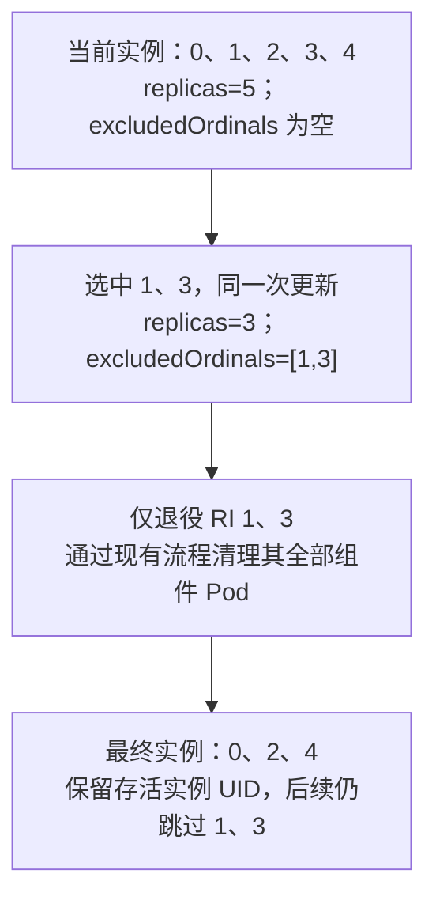
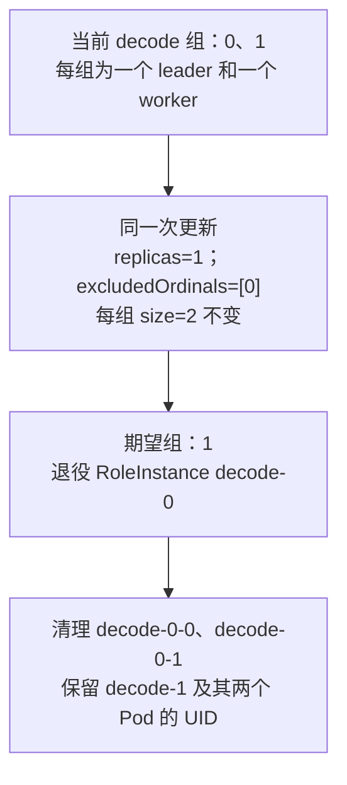
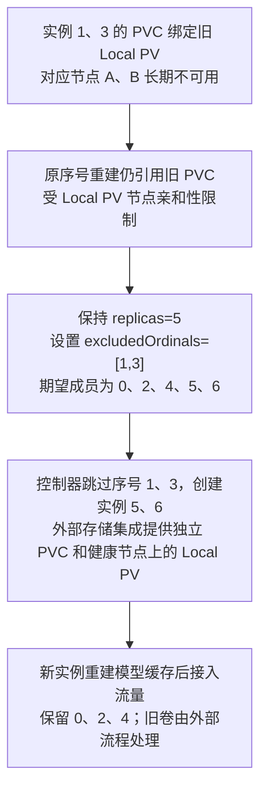
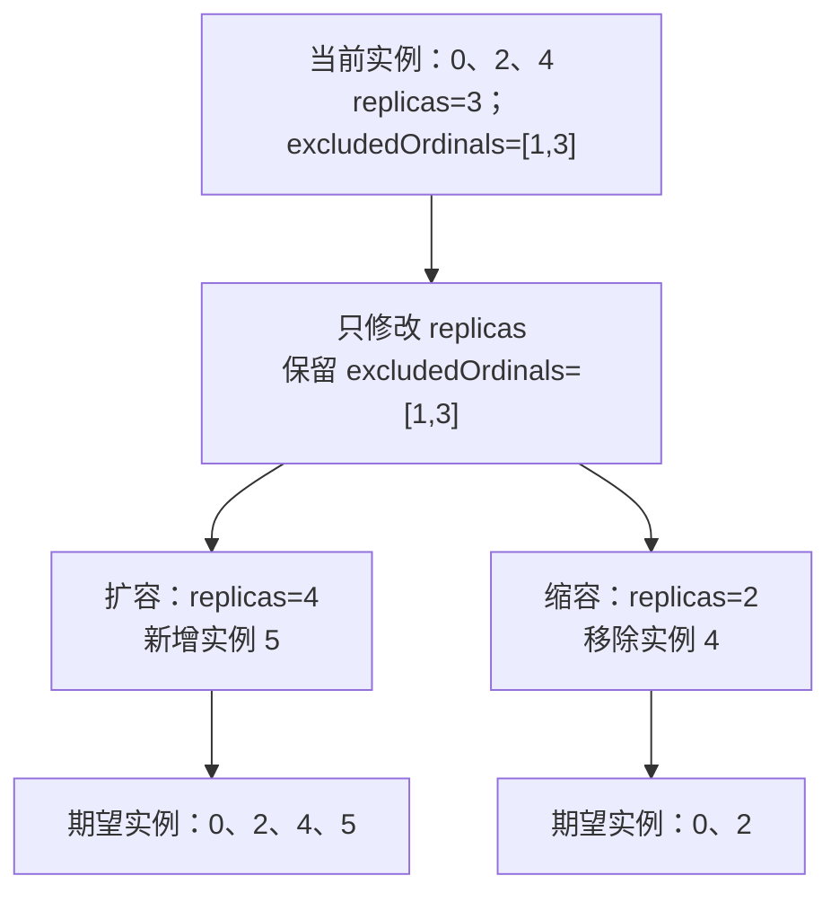
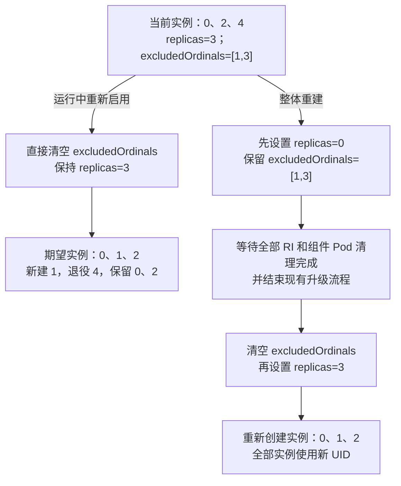

# KEP-499：有状态实例指定缩容

[English](README.md) | 简体中文

> 本文是 [英文提案](README.md) 的中文译文。本文中的“排除的槽位序号”表示控制器应持续跳过、不再创建实例的序号，
> 不表示需要保留运行的实例。提案状态、适用边界和验收要求与英文版本一致。

<!-- toc -->
- [KEP-499：有状态实例指定缩容](#kep-499有状态实例指定缩容)
  - [简介](#简介)
  - [动机](#动机)
    - [目标](#目标)
    - [非目标](#非目标)
  - [提案](#提案)
    - [用户场景](#用户场景)
      - [指定缩容](#指定缩容)
      - [使用新序号替换实例](#使用新序号替换实例)
      - [后续扩缩容](#后续扩缩容)
      - [重新启用序号](#重新启用序号)
    - [注意事项与约束](#注意事项与约束)
  - [设计细节](#设计细节)
    - [API](#api)
    - [期望实例集合](#期望实例集合)
    - [校验与版本转换](#校验与版本转换)
    - [统一序号规划器](#统一序号规划器)
    - [重新启用序号对升级策略的影响](#重新启用序号对升级策略的影响)
      - [单个序号重新启用](#单个序号重新启用)
      - [单次启用数量限制](#单次启用数量限制)
      - [对 partition 的影响](#对-partition-的影响)
      - [共同规则](#共同规则)
    - [ScalingAdapter 与其他写入方](#scalingadapter-与其他写入方)
    - [实施计划](#实施计划)
    - [测试计划](#测试计划)
      - [测试前置准备](#测试前置准备)
      - [单元测试](#单元测试)
      - [集成测试](#集成测试)
      - [端到端测试](#端到端测试)
    - [阶段准入条件](#阶段准入条件)
    - [升级与降级策略](#升级与降级策略)
    - [版本差异策略](#版本差异策略)
    - [待讨论问题](#待讨论问题)
  - [生产就绪评审](#生产就绪评审)
    - [特性启用与关闭](#特性启用与关闭)
    - [依赖](#依赖)
  - [参考资料](#参考资料)
<!-- /toc -->

## 简介

本 KEP 为原生有状态 RoleInstanceSet 增加“按序号指定缩容”的能力。
一个 RoleInstance 代表一个完整实例，可能包含多个组件 Pod。
使用原生 RIS 的 `leaderWorkerPattern` 时，一个 RoleInstance 就是一组 leader 和 worker；
`replicas` 表示组数，`leaderWorkerPattern.size` 表示每组 Pod 总数。
本提案支持指定退役整个组，不支持只永久移除组内某一个 Pod。
运维人员可以选择需要移除的实例，同时保留其他实例的名称、序号和 UID，
适用于模板不变、且没有其他独立生命周期事件的单纯缩容。

为此，在 RBG 的 `spec.roles[i]` 和独立 RIS 的 `spec` 中增加可选字段 `excludedOrdinals`。
`replicas` 继续表示期望实例数量，`excludedOrdinals` 表示控制器需要持续跳过的序号。
每个 RoleInstance 对应一个具有稳定序号的逻辑槽位；在 leader/worker 模式下，一个槽位代表整个组。
槽位序号是身份编号，不是列表位置或节点资源槽位；`replicas` 表示实例数量，不是序号上限。
控制器从 0 开始选取未被排除的序号，直到满足期望数量；删除时以整个 RoleInstance 为单位清理其全部组件 Pod。

例如，当前实例为 `[0,1,2,3,4]`，需要移除 1、3 时，在一次更新中设置
`replicas=3`、`excludedOrdinals=[1,3]`，期望实例变为 `[0,2,4]`。
控制器重启后仍跳过 1、3；后续将 `replicas` 增至 4 时，新增序号 5，得到 `[0,2,4,5]`。
如果只增加排除序号而不减少 `replicas`，控制器会创建其他序号的实例补足数量，表示替换而非缩容。

排除配置是持久化期望状态，不能在缩容完成后自动清空。
字段未配置或为空时沿用现有行为；配置非空时，创建、删除和滚动升级共用同一份序号规划。
升级继续使用现有 partition、maxSurge 和 maxUnavailable，具体适配方式在设计细节中说明。

## 动机

有状态推理实例可能持有有价值的本地模型状态、预热缓存，或者包含多个协同工作的组件 Pod。
在节点维护、重新放置或应用迁移期间，希望退役的目标可能是低序号实例，
而不是普通缩容选择的最高序号实例。

只减少 `replicas` 可能删除健康的高序号实例。直接删除 RoleInstance 并未改变期望身份，
调谐会重新创建它。一次性删除请求无法表达某个身份必须持续不存在。

以英文提案参考的上游 main 提交 `a0b11e6a` 为基准：

- RoleSpec 和 RoleInstanceSetSpec 尚未暴露 `excludedOrdinals`。
- 有状态拓扑中存在一个始终为空的排除集合，作为后续扩展入口。
- 有状态创建和升级的部分路径仍依赖连续序号区间。
- `scaleStrategy.roleInstanceToDelete` 由无状态流程使用，
  不是持久化的有状态身份退役机制。

因此，本提案统一基础成员和额外实例的序号规划，使创建、删除和滚动升级支持非连续序号。

### 目标

- 持久化跳过选定序号，同时保持 `replicas` 表示数量。
- 在模板不变且没有独立生命周期事件的单纯指定缩容中，保留无关存活实例的名称、序号和 UID。
- 以 RoleInstance 为退役单元，支持指定缩容完整的 leader/worker 组，清理选中组的全部组件 Pod。
- 支持独立创建，以及通过 RBG 角色创建的原生有状态 RoleInstanceSet。
- 在非连续序号下，保持现有所有权检查、partition 数量、maxSurge/maxUnavailable 预算、
  暂停升级行为和控制器重启恢复的正确性。
- 排除配置缺失或为空时，保持现有行为。

### 非目标

- 自动选择退役目标、故障处置、流量切换或数据迁移；不提供节点失联后的执行保证。
- 单个组件 Pod 的指定缩容、组内拓扑变更或外部工作负载后端；原生 RIS 的完整 leader/worker 组在支持范围内。
  无状态指定删除行为不变。
- 跨对象事务或新的命令式扩缩容 API。
- 改变起始序号、自动重编号、自动清理排除配置或管理 PVC。
- 扩展生命周期钩子、调度、服务发现或回滚保护状态。

## 提案

新增 `excludedOrdinals`，与 `replicas` 共同定义期望实例集合。
缩减副本数表达容量变化，排除序号表达哪些实例需要持续不存在。

### 用户场景

以下按四种操作分别说明配置和成员变化，图中流程均为拟议行为。
示例假设模板不变、没有其他独立生命周期事件，实际创建和删除仍遵循现有控制策略。
RBG 用户修改角色配置，独立 RIS 用户直接修改集合配置。

`replicas` 决定期望实例数量，`excludedOrdinals` 决定控制器需要持续跳过哪些序号。
控制器根据两者计算期望实例列表，不区分用户的业务操作意图。

指定缩容、使用新序号替换实例、后续扩缩容和重新启用序号，均使用同一套成员规划规则，
不设置独立的场景开关或替换策略。

- 减少 `replicas` 并排除选中序号，实现指定缩容。
- 保持 `replicas` 不变并排除选中序号，使用其他合法序号补足副本。
- 调整 `replicas` 并保留排除配置，实现后续扩缩容。
- 从排除配置中移除序号，允许控制器再次使用这些序号。

实际创建和退役仍遵循现有控制策略及相应预算约束。

#### 指定缩容

**典型背景。** 推理流量下降，计划将 decode 角色从 5 个实例减至 3 个，释放部分 GPU 资源。
运维人员已经选定需要退役的实例 1、3，例如它们涉及待维护节点或属于资源回收清单；
其他实例 0、2、4 已完成模型加载和预热，希望继续运行。
仅减少副本数可能按高序号移除 3、4，无法表达保留 4、移除 1 的意图，因此需要同时指定退役序号和目标数量。
这里选择的是完整 RoleInstance，包含它的全部组件 Pod。

**操作与结果。** 需要减少容量，并指定删除哪些实例时，同时减少 `replicas`，将选中序号加入 `excludedOrdinals`。
例如从 `[0,1,2,3,4]` 中移除 1、3，一次更新为 `replicas=3`、`excludedOrdinals=[1,3]`，
最终保留 `[0,2,4]`，这些存活实例的名称、序号和 UID 不变。
已有排除序号应合并；重试仍提交同一组目标值，不能重复扣减副本。



**Leader/worker 组指定缩容。** 某个 decode 角色有两组实例，每组由一个 leader 和一个 worker 组成。
运维希望回收第 0 组的资源，同时保留已经加载模型的第 1 组。
本场景适用于原生有状态 RIS 的 `leaderWorkerPattern`，不表示支持外部 LeaderWorkerSet 后端。
以下省略工作负载公共前缀：

| RoleInstance（组） | leader Pod | worker Pod | 操作 |
| --- | --- | --- | --- |
| `decode-0` | `decode-0-0` | `decode-0-1` | 退役整个组 |
| `decode-1` | `decode-1-0` | `decode-1-1` | 保留整个组 |

在同一次更新中，将 decode 角色从 `replicas=2`、空排除配置改为
`replicas=1`、`excludedOrdinals=[0]`，保持 `leaderWorkerPattern.size=2`。
下面仅展示拟议的角色字段片段；应在现有配置上修改，保留其他角色和模板字段：

```yaml
name: decode
replicas: 1
excludedOrdinals: [0]
leaderWorkerPattern:
  size: 2
```

`excludedOrdinals` 中的 `0` 指组序号，不是组内 Pod 序号。
控制器退役 RoleInstance `decode-0`，通过现有清理流程删除其两个 Pod；
保留 `decode-1` 及其两个 Pod 的名称和 UID。组件 Pod 的清理是异步的，不保证同时消失。
本次只修改 decode，prefill 和 router 的期望配置不变，也不要求同序号的 P/D 组一起退役。
如果保持 `replicas=2` 只设置 `excludedOrdinals=[0]`，则会用第 2 组补足数量，属于组替换。



**为什么不支持单个组件 Pod 指定缩容。** 例如只永久删除 `decode-0-1`、保留同组 leader，
改变的是组内成员和运行拓扑，不是 RoleInstance 数量。
仅删除 Pod 不会减少组件的期望数量，控制器仍会补齐；
修改角色共享的 `leaderWorkerPattern.size` 则会改变所有组的目标大小，无法只选择某一组中的某个 worker。
对于 TP/PP 等协同推理，组内成员变化还需要推理引擎支持重新配置，不能仅靠删除 Pod 保证其余成员继续运行。
因此，本提案只选择完整组的身份，不增加组内 Pod 排除配置或弹性拓扑协议；单 Pod 故障重建仍遵循现有策略。
请求排空和剩余实例容量检查由现有应用或运维流程处理，本特性不承诺请求级零中断。

#### 使用新序号替换实例

保持 `replicas` 不变，将需要替换的实例序号加入 `excludedOrdinals`。
控制器持续跳过这些序号，并使用其他合法序号补足副本，保留其余实例。

例如，当前 `replicas=5`，实例为 `[0,1,2,3,4]`。
将 `excludedOrdinals` 设置为 `[1,3]` 后，期望实例变为 `[0,2,4,5,6]`：

| 实例序号 | 操作 |
| --- | --- |
| 1、3 | 退役，并在后续调谐中持续跳过 |
| 5、6 | 创建新实例，补足期望数量 |
| 0、2、4 | 保留 |

创建和退役顺序遵循现有控制策略。`replicas=5` 表示期望数量，
不保证整个替换过程中始终有五个可用实例，也不保证新实例就绪后才退役旧实例。

该操作与指定缩容使用相同机制。例如，先缩至三个实例并排除 `[1,3]`，
随后保持排除配置扩回五个实例，也会得到 `[0,2,4,5,6]`。因此，不为此场景增加独立开关。

**应用示例：Local PV 绑定不可用节点。**

如果实例使用的 PVC 绑定了不可用节点上的 Local PV，在原序号重建实例仍可能引用旧 PVC，
继续受到原节点亲和性限制。使用新序号创建实例，可以配合已有的外部存储集成，
为新实例分配独立 PVC 和健康节点上的 Local PV。
Local PV 的节点约束参见 [Kubernetes Local 卷说明](https://kubernetes.io/docs/concepts/storage/volumes/#local)。

此场景需要满足以下条件：

- 外部存储集成能够按实例序号分配并挂载独立 PVC；
  若模板固定引用同一个 `claimName`，更换序号仍会使用原 PVC。
- 模型文件和缓存能够从外部来源重新下载或重建；不可丢失的业务数据需要另行完成复制或恢复。
- 原生 RIS 当前没有 StatefulSet 式的 `volumeClaimTemplates`，本提案不新增该能力，
  也不负责数据迁移、旧卷回收或故障节点上的强制清理。

下图以实例 1、3 的 PVC 分别绑定节点 A、B 上的 Local PV 为例，
说明外部存储集成如何为序号 5、6 的新实例提供存储。
旧对象清理可能阻塞，新实例也可能因缺少可用卷而 Pending。



#### 后续扩缩容

**典型背景。** 完成指定缩容后，decode 角色保留 `[0,2,4]`，排除序号为 `[1,3]`。
先前的维护尚未结束，1、3 需要继续排除。晚间流量上升时，需要从三个实例扩至四个；
低峰时又需要减至两个。运维或自动扩缩容只调整 `replicas`，不清空排除配置，
使新增容量使用其他序号，避免重新创建已经明确退役的实例。
使用 HPA 或 ScalingAdapter 时也应保留排除配置。

**操作与结果。** 仅调整容量时，修改 `replicas` 并保留 `excludedOrdinals`。
以 `[0,2,4]`、`excludedOrdinals=[1,3]` 为起点：扩容到 4 个实例时新增 5，
缩容到 2 个实例时移除 4。两种情况下，1、3 都不会被重新创建。



#### 重新启用序号

**典型背景。** 先前为临时维护排除了实例序号 1、3，decode 角色当前保留 `[0,2,4]`。
维护结束后，运维决定重新启用这些序号，允许控制器再次使用。
在期望数量仍为三个时清空排除配置，控制器会新建 1、退役 4，保留 0、2；
这是一项主动的成员调整，不是指定缩容完成后的必选步骤，也不会因节点恢复自动执行。

另一个场景是计划停机后重新部署服务：先停止全部实例并完成清理，再清空排除配置、重新扩容，
从 0 开始重新建立实例编号。仅为让编号连续而清空配置没有必要，服务可以继续使用非连续序号。

**操作与结果。** 从 `excludedOrdinals` 中移除指定序号，允许控制器再次使用这些序号。
实际创建哪些实例，由当前副本数和排除配置共同决定；即使 `replicas` 不变，期望实例列表也会重新计算。
例如在 `replicas=3` 时，将 `[0,2,4]` 的排除配置清空，期望集合变为 `[0,1,2]`：
新建 1、退役 4，保留 0、2。需要重新创建的实例使用新 UID。
补建与退役顺序受当前剩余升级预算约束，详见[重新启用序号对升级策略的影响](#重新启用序号对升级策略的影响)。

如果需要整体重置编号，可先将 `replicas` 缩至 0，等待全部 RI 及组件 Pod 清理完成、现有升级流程结束，
再清空排除配置并重新扩容。这会先停止全部实例，之后创建的实例使用新 UID。
排除配置不会在缩容完成后自动清理。



### 注意事项与约束

- 适用于独立创建或通过 RBG 角色创建的原生有状态 RIS。RBG 管理的集合以角色配置为准，独立 RIS 直接修改自身配置。
- `excludedOrdinals` 选择 RoleInstance 序号；在 leader/worker 模式下选择整个组，不选择组内 Pod 序号。
- 指定缩容需在一次父对象更新中同时提交副本数和排除序号；多个子对象异步收敛，不构成跨对象事务。
- 排除配置可以使用整数或区间，重复、重叠条目按并集处理。排除配置表示持续跳过这些序号。
- 模板变更、实例自身故障等独立事件仍遵循现有处理流程；指定缩容不承诺请求排空、节点隔离或请求级零中断。

## 设计细节

以下 API 和流程均为拟议设计。示例省略现有 pattern 和 Pod 模板，不能直接作为完整部署清单使用。

### API

在两个原生期望状态入口增加可选字段：

```go
// RoleSpec
ExcludedOrdinals []intstr.IntOrString `json:"excludedOrdinals,omitempty"`

// RoleInstanceSetSpec
ExcludedOrdinals []intstr.IntOrString `json:"excludedOrdinals,omitempty"`
```

条目可以是非负整数，或包含两端的区间字符串，例如 `"3-5"`。
数字字符串 `"3"` 与整数 `3` 含义相同。
重复或重叠条目按集合并集处理，不代表需要额外扣减副本。
控制器在内部归一化区间，不改写用户配置。

对于 RBG 管理的集合，`spec.roles[i].excludedOrdinals` 是权威配置，
并应与 replicas 在同一次调谐写入中传播到对应子对象。
直接修改受管子对象不是第二个控制入口。
RoleBasedGroupSet 和 RoleTemplate 展开流程也必须保留该角色字段。

以下是拟议的角色配置片段，省略现有 pattern 和 Pod 模板。当前发布版本尚不支持这些字段。

```yaml
apiVersion: workloads.x-k8s.io/v1alpha2
kind: RoleBasedGroup
metadata:
  name: serving-group
spec:
  roles:
    - name: decode
      replicas: 3
      excludedOrdinals: [1, 3]
```

对于独立管理的原生 RoleInstanceSet：

```yaml
apiVersion: workloads.x-k8s.io/v1alpha2
kind: RoleInstanceSet
metadata:
  name: decode
spec:
  replicas: 3
  excludedOrdinals: [1, 3]
```

### 期望实例集合

设 `N` 为期望副本数，`E` 为归一化后的排除序号集合。
定义 `A(N,E)` 为按升序排列的、**不属于 E 的前 N 个非负整数**。
这是稳态成员集合，与当前实际存在的实例无关。

| N | E | A(N,E) | 含义 |
| --- | --- | --- | --- |
| 5 | 空 | 0,1,2,3,4 | 现有连续序号行为 |
| 3 | 1,3 | 0,2,4 | 指定移除两个实例 |
| 5 | 1,3 | 0,2,4,5,6 | 在新序号上补足退役容量 |
| 4 | 1,3 | 0,2,4,5 | 扩容时仍跳过已排除序号 |
| 3 | 1,3,100 | 0,2,4 | 排除未来序号不占用副本数 |
| 2 | 0-3 | 4,5 | 跳过已排除的前缀 |
| 0 | 任意合法 E | 空 | 不期望任何实例 |

因此，`N + len(E)` 通常不能作为合法的结束序号。
远超活动前缀范围的排除不会扩大当前窗口。
状态副本数应统计实际实例，不能统计序号跨度或被排除的槽位数。

### 校验与版本转换

- 仅对原生有状态 RoleInstanceSet 路径接受非空排除配置。
  对无状态角色和不支持的兼容工作负载应拒绝，不能静默忽略。
  必须检查实际后端和 pattern；通用“有状态角色”辅助函数也可能将不支持的外部工作负载归入其中。
- 校验整数、区间语法、非负端点、区间上下界顺序，以及每个生成序号是否可表示。
  数量和区间边界计算使用更宽的整数。拟限制最多 1,024 个输入条目，具体资源上限待 API 评审。
- 联合校验目标 replicas、排除配置和升级策略，包括现有非零副本下的 partition、预算约束。
  不能为使扩缩容请求通过而静默改变 partition 或升级策略。
- 使用合并区间和有界遍历，不能按最大排除序号或区间长度展开。
  设 S 为按照现有规则从 maxSurge 计算出的额外副本上限。
  如果未被排除的合法序号不足以容纳 N 个基础实例和最多 S 个额外实例，应拒绝目标配置。
- 增加结构化 schema、deepcopy、客户端生成和转换覆盖。
  所有能更新同一存储对象的 served API version，均必须在往返转换中保留排除配置，
  包括 RBGSet 模板。存在有损转换路径时不能启用特性。
- 客户端写入字段前必须先升级 CRD 和 webhook。客户端应采用严格服务端字段校验；
  如果未知排除字段被裁剪，而较小的副本数被接受，就会选错删除目标。

### 统一序号规划器

使用统一规划器计算本次调谐应保留的实例序号，供创建、删除和升级等流程共用。

**未配置 excludedOrdinals，或配置为空：** 按现有连续序号规则计算。
例如 `replicas=3` 时，基础实例序号为 `[0,1,2]`。

**配置了 excludedOrdinals：** 从 0 开始跳过排除序号，选取前 `replicas` 个合法序号。
例如 `replicas=3`、`excludedOrdinals=[1,3]` 时，基础实例序号为 `[0,2,4]`，数量仍为 3。
它们在列表中的位置依次是 0、1、2，这就是逻辑排名，用于按数量处理 partition。

滚动升级需要额外实例时，继续从基础集合之后选择未被排除的序号，并遵守 `maxSurge` 预算。
例如上述两种情况在 `maxSurge=1` 时，可分别使用序号 3 和 5。
是否创建或保留额外实例，仍由现有升级配置和状态决定。

实现时遵守以下约束：

- 只创建规划中缺失的实例，将不再属于规划集合的实例交给现有删除流程。
  删除以 RoleInstance 为单位，清理其全部组件 Pod，并遵守现有所有权和 finalizer 约束。
- 合并并直接跳过排除区间，不为排除位置分配数组槽位或逐个遍历。
  例如排除 `"0-1000000000"` 时，应直接从 1000000001 开始计算。
- 仅修改 `replicas` 或 `excludedOrdinals` 不触发模板滚动升级；仍按新的期望集合创建或删除实例，
  无需变更的存活实例不应因此重建。父子对象同步时保留两个字段，包括显式清空排除配置。

### 重新启用序号对升级策略的影响

从 `excludedOrdinals` 中移除指定序号，允许控制器再次使用这些序号。
实际创建哪些实例，由当前副本数和排除配置共同决定。
这可能需要创建低序号实例、退役高序号实例；创建和退役仍受升级预算约束。

仅修改排除配置不触发模板升级，相关操作与正在进行的升级共用 `maxSurge`、`maxUnavailable` 预算。

#### 单个序号重新启用

以 `replicas=3`、`excludedOrdinals=[1,3]`、实例 `[0,2,4]` 为例。
将排除配置改为 `[3]` 后，期望实例变为 `[0,1,2]`：创建 1、退役 4，保留 0、2。

假设原实例均可用，且预算未被占用：

| 配置 | 推进方式 |
| --- | --- |
| `maxSurge=0`、`maxUnavailable=1` | 先退役 4，删除完成后创建 1，等待其可用。 |
| `maxSurge=1`、`maxUnavailable=0` | 先创建 1，等待其可用后再退役 4。 |

前一种配置若先创建 1，会突破额外副本预算；后一种配置若先退役健康实例 4，会突破不可用预算。

#### 单次启用数量限制

生产中，每次重新启用序号时，实际需要新增的实例数量应满足以下限制：

| 推进方式 | 单次新增实例数量限制 |
| --- | --- |
| 先退役旧实例，再创建新实例 | ≤ `maxUnavailable` |
| 先创建新实例，再退役旧实例 | ≤ `maxSurge` |

如果预算已被正在进行的升级或不可用实例占用，应按剩余预算进一步减少单次新增实例数量。

**超过该限制时，集中创建实例可能突破数量或可用性预算，导致不符合预期的升级行为。
用户应分批从 `excludedOrdinals` 中移除序号，每批完成并恢复可用后再继续，不依赖控制器自动拆批。**

例如 `replicas=3`、`excludedOrdinals=[1,2,3]`，当前实例为 `[0,4,5]`。
需要重新启用序号 1、2，且 `maxSurge=1`、`maxUnavailable=0` 时，应分两次操作：

1. 将排除配置改为 `[2,3]`，等待实例收敛为 `[0,1,4]` 且全部可用。
2. 再改为 `[3]`，等待实例收敛为 `[0,1,2]` 且全部可用。

每次只新增一个实例，符合 `maxSurge=1` 的限制。
若一次改为 `[3]`，同时创建 1、2，实例总数会从 3 增至 5，超过允许的 4 个。

新增实例数量按新旧期望实例列表的差异计算。
例如清空 `[1,3]` 后，实例从 `[0,2,4]` 变为 `[0,1,2]`，只需创建实例 1，新增数量为 1。

#### 对 partition 的影响

`partition` 按新的期望实例列表的位置计算，重新启用序号可能改变灰度范围。

例如 `partition=2`：

| 排除配置 | 期望实例 | 保留旧版本的实例序号 | 允许升级的实例序号 |
| --- | --- | --- | --- |
| `[1,3]` | `[0,2,4]` | 0、2 | 4 |
| `[3]` | `[0,1,2]` | 0、1 | 2 |

即使 `partition` 不变，重新启用序号后实例 2 也可能进入允许升级的范围。
新建实例沿用现有 revision 选择规则。

`partition=0` 时，全部基础实例都允许升级。`partition` 不放宽实例创建和退役的预算限制。

#### 共同规则

- 百分比以 `replicas` 为基数，沿用现有取整和校验规则。
- 排除序号不算缺失副本；实际缺失、不可用、正在终止的实例及已有额外实例，按现有规则参与预算计算。
- 新实例满足 revision、健康和 `minReadySeconds` 条件后，才能提供可用性缓冲。
- 暂停时保留已有合法额外实例，不因排除配置变化新建升级额外实例；退役和后续替换仍需遵守预算。
- 升级结束后清理额外实例，不扰动期望集合中的存活基础实例。可用性预算不等于请求级零中断保证。

### ScalingAdapter 与其他写入方

排除配置不会转移现有 HPA、ScalingAdapter 或其他写入方对副本数的控制关系。
人工指定缩容前，需要显式完成副本控制权交接。

**阻止旧 adapter 的在途写入。** 当前
[adapter 控制器](../../internal/controller/workloads/rolebasedgroupscalingadapter_controller.go)
遇到 RBG 更新冲突后，仍可能重试写入旧目标值，删除 adapter 不会取消该操作。
后续实现必须将每次写入绑定到发起操作时的 RBG UID、角色和 adapter UID。
每次写入前，包括冲突重试，都先通过非缓存读取 RBG，再读取当前 adapter，
确认同一 RBG 仍启用了该角色的 adapter，adapter 的 UID 一致、已绑定同一 RBG 和角色，且未进入删除流程。
使用本次读取的 RBG UID 和 resourceVersion 做条件更新。
发生冲突后重新读取并重复全部检查；对象被禁用、删除、替换或身份不匹配时，终止旧操作，不再写回旧副本数。

这样，旧写入要么在禁用操作之前提交，要么发生冲突并在重试时发现角色已禁用。
重新启用后，旧操作也必须因 adapter UID 不匹配而失效。
其他副本写入方同样需要先完成在途写入，或具备阻止旧写入的机制。

**禁用时保留实际生效的副本数。**
[RBG 调谐器](../../internal/controller/workloads/rolebasedgroup_controller.go)
在角色禁用 adapter 后，立即停止使用 adapter 的副本数覆盖值。
单独禁用可能使副本数回落到角色中保存的较小值。因此，运维流程应为：

1. 停止竞争性的写入方，包括 HPA 对 adapter 的写入，确认在途写入已完成或被阻止。
   直接从 API Server 读取 RBG 和当前已绑定的 adapter，记录其 UID 和版本。
2. 在同一次 RBG 条件更新中，将实际生效的副本数写入角色的 `replicas`，
   同时设置 `scalingAdapter.enable=false`，保留排除配置。
   adapter 覆盖生效时使用其 `spec.replicas`，否则使用角色现有副本数。
   更新需检查 RBG UID 和 resourceVersion；冲突后重新读取两个对象并计算，不能重用旧值。
3. 确认上述写入检查已生效，并通过非缓存读取等待旧 adapter 完全消失。
   删除时间戳或对象消失本身，都不能证明在途写入已被阻止。
   然后在保持 adapter 禁用的情况下，以条件更新提交人工目标 `(N,E)`。
4. 指定缩容完成后再重新启用，等待具有新 UID 的 adapter 从当前角色副本数初始化并绑定，
   再恢复 HPA 等写入方。旧 UID 对应的操作仍不得写入。

例如，角色中保存的副本数为 1，但已绑定 adapter 使实际副本数为 5，
步骤 2 必须同时写入 `replicas=5` 和 `enable=false`。
在单独提交 `N=3,E={1,3}`、选定 `[0,2,4]` 之前，先保持原来的五个身份。
若副本数仍为 1 就禁用 adapter，可能在指定缩容目标生效前误删需要保留的实例。

这是客户端编排，并依赖控制器的写入检查，不构成跨对象事务。
上述检查和并发写入测试是后续实现的前置条件；当前控制器不能仅靠删除 adapter 提供这一保证。
前置条件部署并验证完成前，不能将该流程视为安全交接。

后续自动扩缩容可以修改 N，同时保留 E；新容量跳过已排除的身份。
本 KEP 不承诺在自动扩缩容器主动选择不同 N 时，人工目标 N 仍然保持。
直接使用 RIS 的用户同样需要协调副本写入方，现有 scale 子资源必须保留排除配置。

### 实施计划

本次 PR 仅包含 KEP 和元数据。后续实现应：

1. 增加 API 校验、schema、生成代码和转换，将独立启动参数接入准入与调谐，并提供 Helm 配置。
2. 实现统一规划器，以及父对象和模板传播。
3. 集成有状态实例创建、删除和全部组件 Pod 清理，沿用现有所有权与清理约束。
4. 使 partition、maxSurge、maxUnavailable、暂停升级和 status 统计支持非连续成员，
   将重新启用序号后的实例创建和退役纳入共享预算，并说明用户分批解除排除的操作限制。
5. 增加 adapter 每次写入检查和保留生效副本数的交接，验证并发写入冲突、
   保存值与生效值不一致，以及其他副本写入方的互操作。
6. 启用前补齐验收测试和运维文档。

步骤 1—5 共同构成特性启用的完整性要求；
中间提交必须保持特性关闭，不能暴露部分退役行为。

### 测试计划

本次仅包含 KEP 的 PR 不增加实现测试，也不表示以下场景已经通过。
它们是后续实现的验收要求。

#### 测试前置准备

先记录空排除配置下的连续序号行为，复用现有有状态创建、删除和升级测试作为回归基线。
测试辅助函数需按实际序号查找实例并记录 UID，不能假定所有成员都位于 `[0,replicas)`。

#### 单元测试

- 解析整数、数字字符串、区间、重叠和重复、负数、非法边界、较长的被排除序号前缀，以及溢出和资源上限。
- 验证成员表、排除未来序号、缩容到零、部分取消排除，以及不压缩身份的扩缩容。
- 校验后端和 pattern 限制、启动开关配置及其准入和调谐行为、模板展开、served version 往返转换和 scale 子资源保留。
- 验证副本或 revision 哈希不会将仅成员变化转为滚动升级。
- 覆盖基于排名的 partition、maxSurge/maxUnavailable 的现有百分比取整、
  额外实例的非连续序号分配、暂停升级，以及 E/N 变化后的成员重算。
- 验证 maxUnavailable 为零、非零整数和百分比时的预算；排除空洞不算缺失，期望成员不可用不漏算，未可用的额外实例不提供缓冲。
- 验证重新启用序号后实际需要新增的实例数量，不按排除条目数计数；覆盖零预算、已有预算占用、
  先补建和先退役的单次新增实例数量限制，以及新的期望列表导致的 partition 归属变化。

#### 集成测试

- 直接保持 N=5、排除 E={1,3}，与先缩至 N=3、E={1,3} 再扩回 N=5，
  最终均得到 [0,2,4,5,6]；两条路径使用同一规划器和能力开关，不按业务场景分支。
- 在条件禁用前阻塞 adapter 的副本写入，使其发生冲突，待删除 adapter 并提交人工目标后再恢复；
  旧操作必须终止，不得覆盖 N/E 或改变存活实例 UID。重新启用新 UID 的 adapter、
  同名 RBG 删除重建后重复验证，旧操作均应失效。
- 角色保存 replicas=1、已绑定 adapter 使副本数实际为 5 时，观察交接更新同时保存 replicas=5
  并禁用 adapter，E 不变，再提交 N=3,E={1,3}；中间调谐不得缩至 1，0/2/4 保留 UID。
  在禁用更新前注入冲突，验证重新读取和计算生效副本数。
- RBG 和 RBGSet 将 N/E 一起传播到原生子集合；RoleTemplate 展开和转换保留二者，
  直接修改子对象不能覆盖父配置。
- 从 N=5 收敛到 N=3、E={1,3}：选中实例消失，0/2/4 保留 UID，
  每个退役实例的全部组件 Pod 通过所属 RoleInstance 的现有清理流程退役。
- 原生有状态 leader/worker 角色从两组、每组两个 Pod 缩至一组，设置 N=1、E={0}：
  第 0 组 RI 及其两个 Pod 清理完成，第 1 组 RI 及其两个 Pod 保留 UID，组大小仍为 2；
  prefill/router 配置不变时，不因本次成员变化触发其重建；控制器重启后也不补回第 0 组。
- 删除或滚动升级期间重启控制器：重新读取 N/E，排除序号不被重建，
  成员集合和升级预算按当前配置恢复调谐。
- 覆盖单个序号重新启用和用户分两次解除排除的案例，每次等待收敛并全部可用，记录实例数量和可用数量；
  重新启用序号与模板升级并发时共用预算，补建未可用、旧成员正在终止或控制器重启时也不得超额，
  无关存活实例保留 UID。
- 重试相同绝对 patch，覆盖过期 resourceVersion/UID 前置检查，
  验证无关配置和重建后的父对象不被覆盖。

#### 端到端测试

- 单 Pod 和多组件原生有状态角色，检查健康存活实例 UID。
- 指定缩容、N 不变的替换、后续扩容、区间排除、零副本，
  以及显式停止、重置、重新启动的身份重置流程。
- 暂停或运行中的滚动升级，结合非零 partition、maxSurge/maxUnavailable 百分比预算、
  控制器重启，以及涉及额外实例序号的排除配置变化。
- 节点失联场景：观察清理阻塞，经过外部隔离后恢复；
  验证本特性不自动强制删除，也不宣称提供节点隔离。
- 覆盖保留副本数的禁用、阻止在途旧写入、旧对象移除和新 UID 的重新启用，
  再执行保留 E 的 HPA 扩缩容；保存值与生效值不一致时，交接全过程仍保留人工目标和存活实例 UID。
- 空 E 回归：普通扩缩容、有状态升级、无状态指定删除、兼容工作负载和所有权检查保持不变。

### 阶段准入条件

本功能拟沿用项目现有的独立启动参数方式，引入默认关闭的开关：

```text
--enable-stateful-excluded-ordinals=false
```

Helm 提供对应配置项。启用后，允许原生有状态 RIS 及对应 RBG 角色使用 `excludedOrdinals`，
准入和调谐使用一致的开关配置。
元数据中的 `StatefulExcludedOrdinals` 是能力名称，运行时由上述拟议参数控制。

开关统一控制排除序号能力，不分别控制指定缩容、使用新序号替换实例或重新启用序号。

关闭时拒绝非空排除配置。控制器遇到已持久化的非空配置时，应报告不支持，
不能静默忽略字段或回退到连续序号逻辑。存在运行中的非连续成员时，不支持直接关闭开关。

Alpha 启用前，应完成以下验收：

- schema、版本转换、父子对象传播和成员规划链路完整。
- 非连续扩缩容、升级预算、暂停行为和控制器重启恢复符合预期。
- 指定缩容保留无关存活实例；后续扩容持续跳过排除序号；重新启用序号遵守单次操作预算。
- adapter 在途写入不会覆盖人工目标；禁用 adapter 时保留实际生效的副本数，
  并覆盖保存值与生效值不一致的情况。
- 未配置或空配置保持现有行为，关闭开关及不支持的后端能够明确拒绝非空配置。

Beta 阶段进一步验证多组件清理、节点故障、版本差异和自动扩缩容，完善运维文档，
并由维护者评审默认值和资源上限。

上述内容属于后续实现的验收要求，不表示当前已完成运行验证，也不承诺目标发布版本或阶段晋级批准。

### 升级与降级策略

1. 在排除配置写入方之前升级 CRD、转换和校验 webhook。
2. 升级所有可能调谐这些对象的控制器；存在非空排除配置时，
   不能同时运行仅支持连续序号的旧调谐器。
3. 只有版本转换、成员规划、创建删除、升级预算适配和 adapter 交接保护均已部署验证后才启用特性，
   然后允许用户写入 E。
4. 正常升级保留排除配置。仅保留未知字段，不代表旧控制器能安全调谐非连续期望成员。

运行中的非连续成员存在时，不支持关闭开关或降级。
这对应待评审元数据中的 `disable-supported: false`。
降级前，应停止副本写入方、缩容到零、完成归属实例清理并结束现有升级流程、
清空排除配置，并验证对象兼容连续序号逻辑，再启动旧控制器。
运行中切回连续身份是独立、需显式执行且可能引起中断的用户操作，不是自动回滚行为。

### 版本差异策略

| 组合 | 要求 |
| --- | --- |
| 新 CRD、新控制器、旧对象 | 未配置排除序号时保持现有行为。 |
| 新 CRD、旧控制器 | 存在非空排除配置时，不允许旧控制器继续按连续序号调谐。 |
| 旧 CRD、新客户端 | 写入前先升级 schema 和 webhook，避免字段被裁剪但缩容生效。 |
| 多个 served API version | 能更新同一存储对象的版本必须在转换和写回时保留排除配置。 |

兼容组合需通过真实 API Server 的转换和更新测试后才能启用特性。
仅保留未知字段不能证明旧控制器能够安全处理非连续实例。

### 待讨论问题

- API 评审中确认整数、区间表达方式和拟议输入条目上限。
- 对照现有按数量定义的 API 契约，评审基于排名的 partition 映射。
- 确认独立启动参数名称、Helm 配置、引入版本，以及未来默认启用的条件。
- 评审更强的写入方协调自动化是否应放入后续 API。

## 生产就绪评审

以下内容是发布前需要验证的要求，不表示已有运行结果。

### 特性启用与关闭

| 问题 | 方案与验证要求 |
| --- | --- |
| 如何启用？ | 拟通过独立参数 `--enable-stateful-excluded-ordinals=true` 统一启用，提供 Helm 配置，默认关闭；名称和目标版本待评审。 |
| 默认行为是否改变？ | 未配置或清空排除序号时使用连续成员规则；从非空配置清空时，需按新成员集合重新调谐。 |
| 能否直接关闭或降级？ | 运行中的非连续成员存在时不支持；先停止副本写入、缩容到零并完成清理，再清空配置。 |
| 启用与恢复是否验证？ | 尚无实现结果；空配置回归、开关关闭时拒绝非空配置、重启恢复和降级流程均列入验收。 |

### 依赖

依赖现有 Kubernetes API Server、RBG/RIS/RI 控制器及其子对象清理流程，不新增 CRD 类型或外部服务。
使用 HPA 或 ScalingAdapter 时，人工指定缩容期间需协调副本写入方。
节点或 API 不可用可能阻塞清理，恢复后继续按持久化配置调谐，不自动强制删除。

## 参考资料

- [跟踪议题 #499](https://github.com/sgl-project/rbg/issues/499)。
- [InstanceSet KEP](../30-instanceset/README.md)。
- [当前 RoleInstanceSet API](../../api/workloads/v1alpha2/roleinstanceset_types.go)。
- [当前有状态拓扑和升级辅助函数](../../pkg/reconciler/roleinstanceset/statefulmode/stateful_instance_set_utils.go)。
- [当前有状态控制流程](../../pkg/reconciler/roleinstanceset/statefulmode/stateful_instance_set_control.go)。
- [当前父对象所有权保护 #500](https://github.com/sgl-project/rbg/pull/500)。
